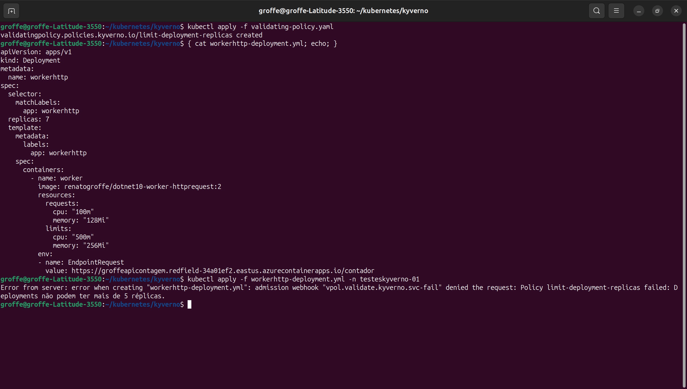
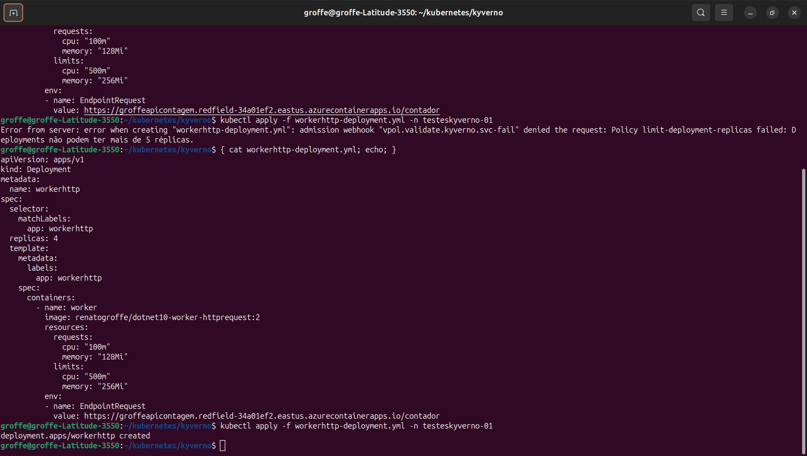

# kyverno-validating_policy-limit-deployment-replicas
Exemplo de ValidatingPolicy criada com o projeto Kyverno para limitar o número máximo de réplicas ao efetuar deployments em um cluster Kubernetes.

## Testes

Um exemplo de erro ao criar um Deployment com 7 réplicas:

O mesmo Deployment criado com sucesso utilizando 4 réplicas:

